# clip_star demo walkthrough

A 10-minute click-through of the demo workspace. Use it for the live call, or send it to people exploring the hosted demo on their own.

**Demo login:** `maya@moneyminutes.demo` / `demo-clipstar-2026`
**Demo address:** {DEMO LINK}. It will be hosted later; locally it's http://localhost:3000.

The demo is "Maya Money", a made-up personal-finance creator with one podcast episode and 9 practice accounts. The clips were cut, captioned and rendered by the real pipeline. Posts, views, followers and comments come from **practice accounts**: they're simulated, and the yellow banner on screen says so. Nothing was really posted.

## Make your own demo

```bash
cd backend
CLIPSTAR_DATABASE_URL=postgresql+psycopg://postgres@localhost:5432/clipstar_demo \
CLIPSTAR_STORAGE_DIR=/var/lib/clipstar-demo \
python -m clipstar.demo        # about 10 minutes; prints the login at the end
```

It needs Postgres and FFmpeg, but no API keys and no Whisper. The episode ships with its own captions file.

---

## The route (follow the sidebar top to bottom)

### 1. Overview: "this is your whole operation on one screen"
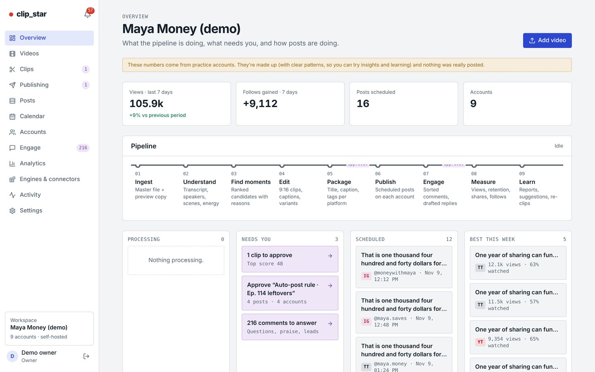
- The top cards show views and followers gained over 7 days, posts scheduled, and accounts.
- **Pipeline** shows the nine stages, from Ingest to Learn. Every stage is a plug-in: free engine or your own paid tool.
- **Needs you** is the only to-do list: a clip to approve, a rule batch waiting, and comments to answer.
- **Best this week** shows top posts by views and watch time.

### 2. Videos → the episode: "one long video in"
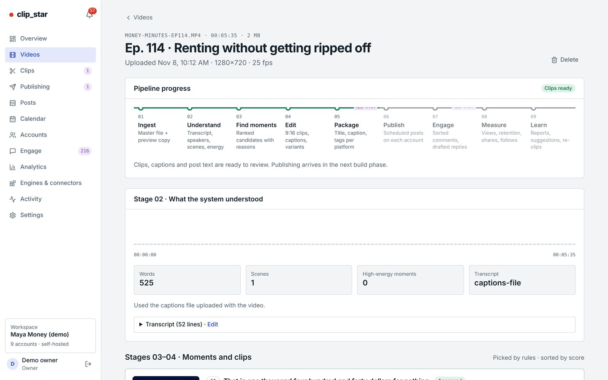
- Upload a file, paste a Drive/Dropbox link, or get an alert when a new YouTube upload appears.
- See the progress through every stage, and the clips it produced.
- **Transcript** opens the transcript editor (fix a word once, and it's fixed in every clip).
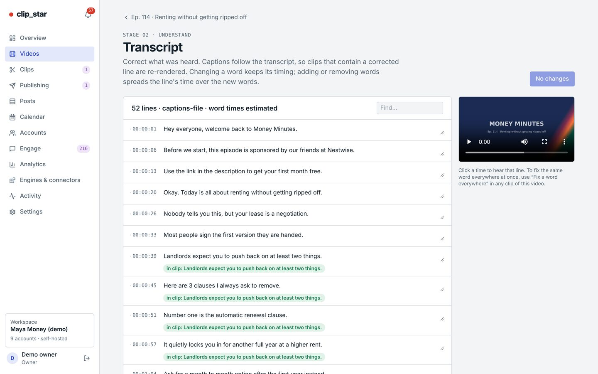

### 3. Clips: "it picks the moments and tells you why"
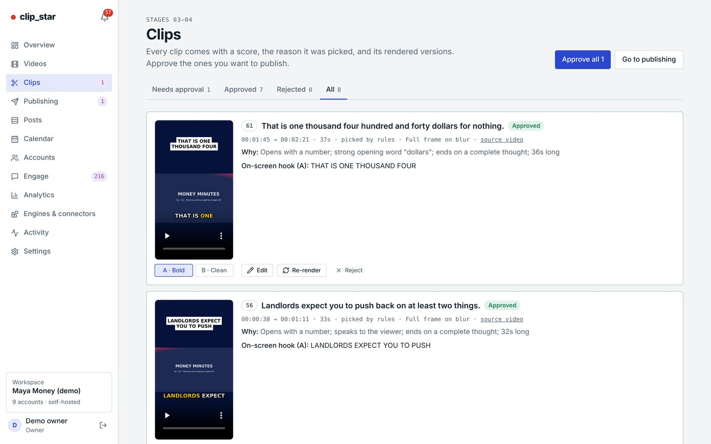
- Each clip has a score, timecodes, and a plain **Why** ("Opens with a number; ends on a complete thought").
- Each clip has two rendered versions, **A · Bold** (word-by-word captions) and **B · Clean**, for A/B testing.
- Approve or reject one at a time, or **Approve all**. Auto-approve above a score is a setting.

### 4. Clip editor: "full control when you want it"
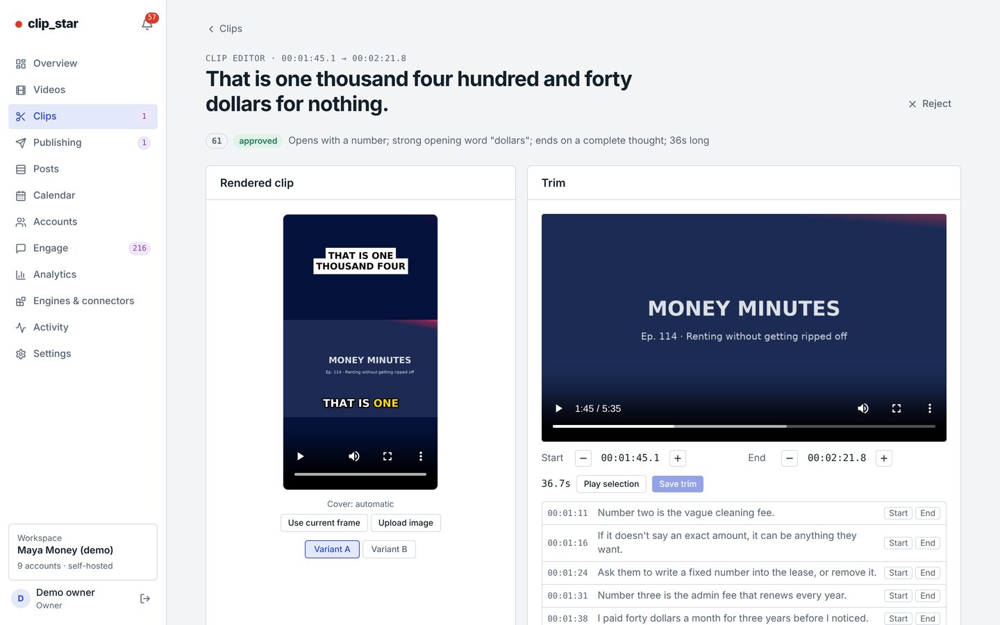
- Trim on sentence boundaries, set the hook text, caption style, zooms, emojis, music and cover image per version.
- Edit the post text per platform, with limit checks (length, hashtags).
- Add a dub into another language (ElevenLabs, with your own key).

### 5. Publishing: "a batch is a whole campaign"
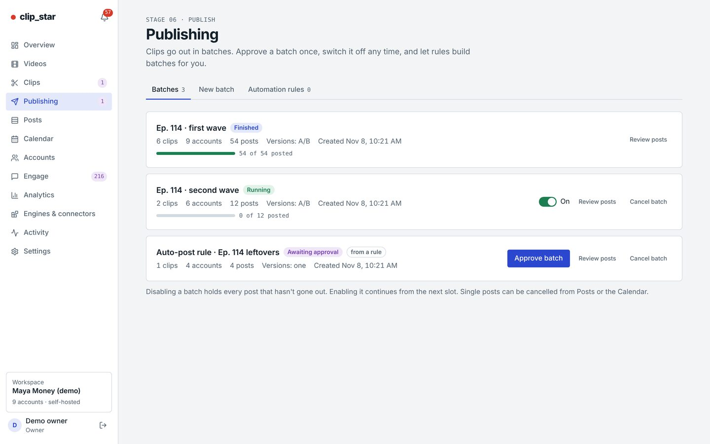
- "First wave" has finished, "Second wave" is running, and an **automation rule** made a batch that is waiting for one-click approval.
- **Try:** open the waiting batch and press **Approve**. Or turn approval off in the rule and it posts by itself.
- Scheduling follows posting hours per time zone, daily caps per account, spacing between posts, and A/B splits across accounts, and never posts twice.

### 6. Calendar: "every post, every account, one week"
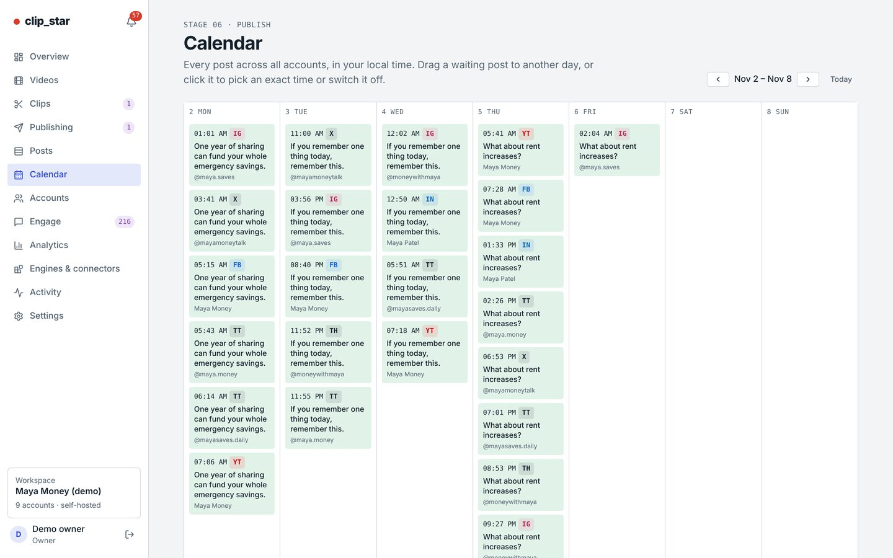
- **Try:** drag a waiting post to another day. It warns you if that breaks a rule (too many posts that day, too close together).

### 7. Posts and Accounts: "9 accounts, 7 platforms, one place"
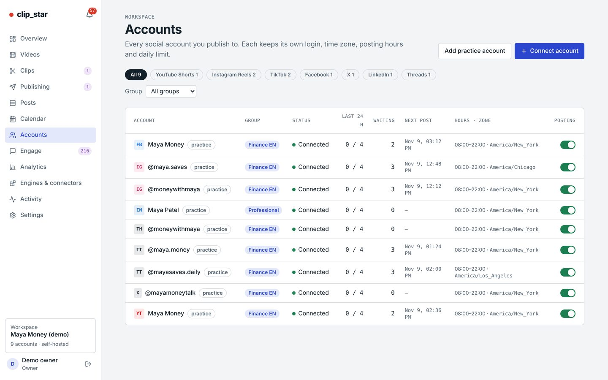
- The accounts are Instagram ×2, TikTok ×2, YouTube, Facebook, X, LinkedIn and Threads. Pinterest is supported too.
- Real accounts connect through each platform's own login screen (official API). Nobody shares a password.
- Open any account for its followers over time and its best posts.
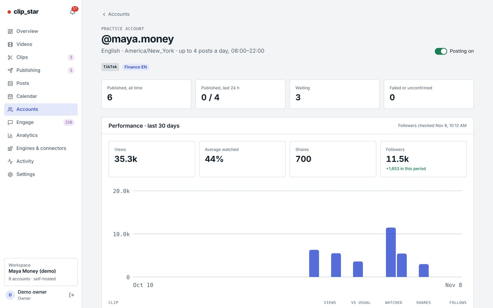

### 8. Engage: "comments sorted for you"
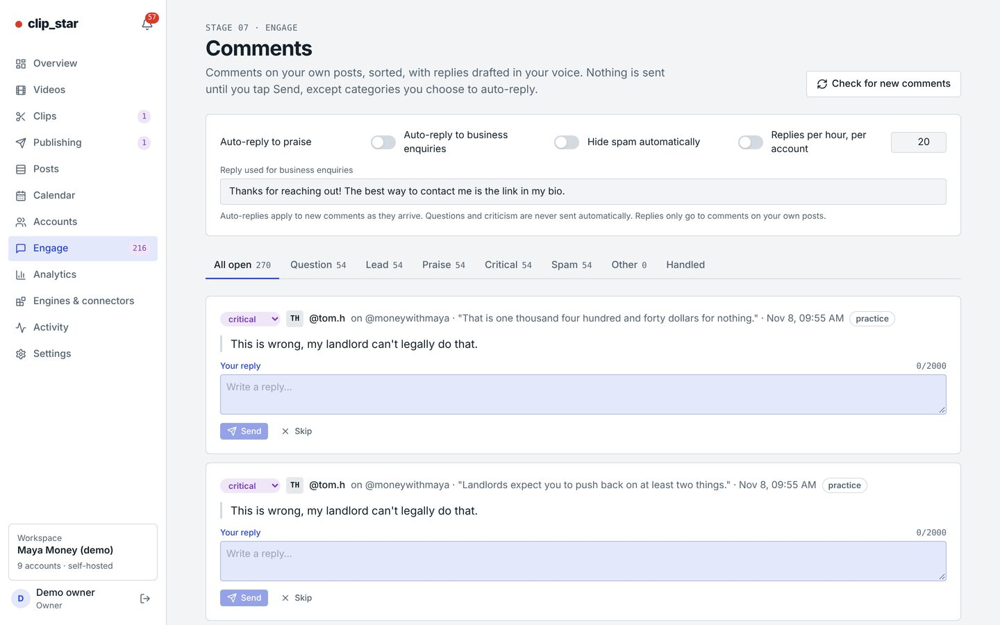
- Comments are sorted into questions, leads, praise, criticism and spam, with reply drafts ready.
- Send, edit or hide. Rules can auto-reply to set categories, with rate limits.

### 9. Analytics: "it learns what works"
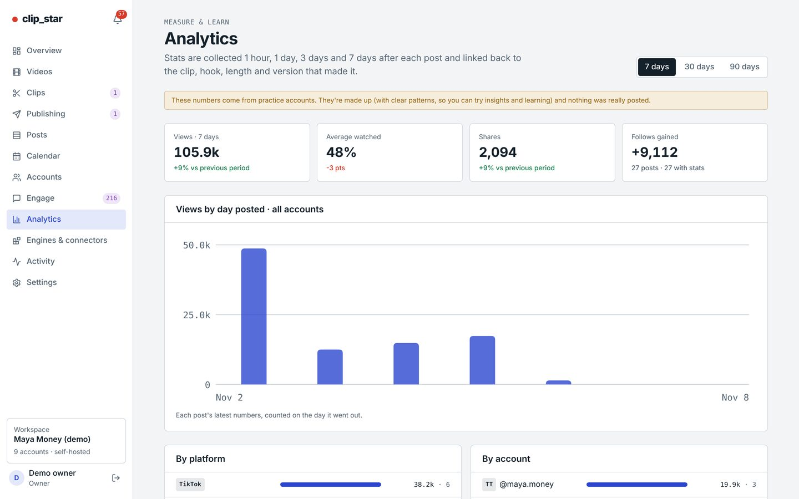
- Views, watch time, shares and followers per day, per platform and per account.
- **Insights** compare clip length, hook type, posting hour and caption style, and give suggestions, like "Posts with 35–50 s got 63% more views" in this demo. A weekly report arrives by email or phone.
- The scoring learns per creator, so the next video's picks lean toward what worked.

### 10. Engines & connectors: "free by default, plug in what you already pay for"
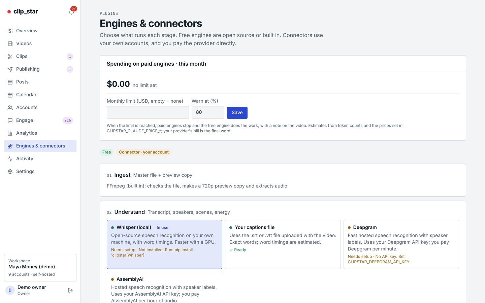
- For each stage, pick the free engine (Whisper, the rules engine, templates) or a connector with your own key (Claude, OpenAI, Deepgram, AssemblyAI, ElevenLabs, Pexels, Klap, Vizard, or a local model through Ollama).
- A monthly spending cap applies. Over the cap, the free engine takes over.

### 11. Settings: "your rules"
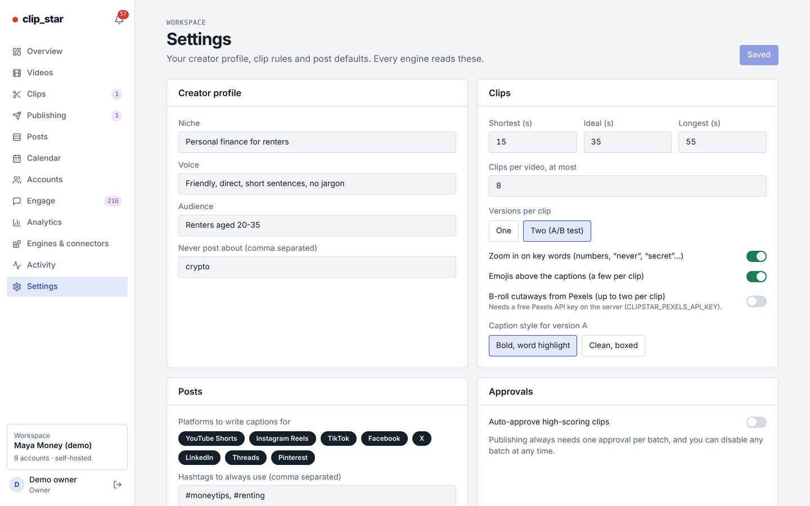
- Clip length, number of clips, caption look, banned topics, AI-content labels, team and roles, notifications, API keys and webhooks, backups, storage clean-up.

### On a phone
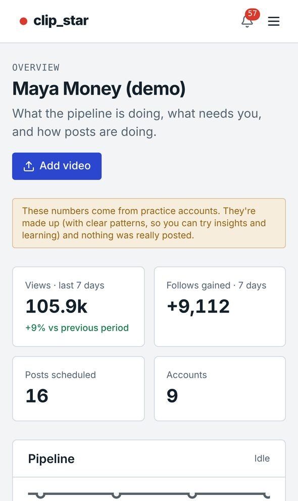 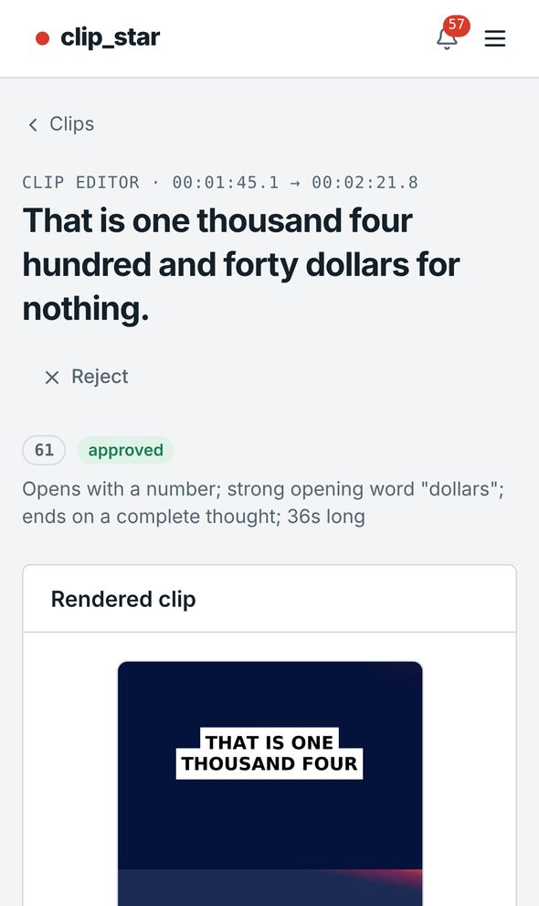
- It installs as an app and sends push notifications for "batch waiting" or "post failed". You can approve from a phone.

---

## Close the call with

1. "Want me to run one of your videos through it this week?"
2. Which platforms and how many accounts they run. Their first rule ("post approved clips at 9am and 6pm on all TikToks").
3. Where they'd run it: their own computer, a small server, or one you set up for them.
